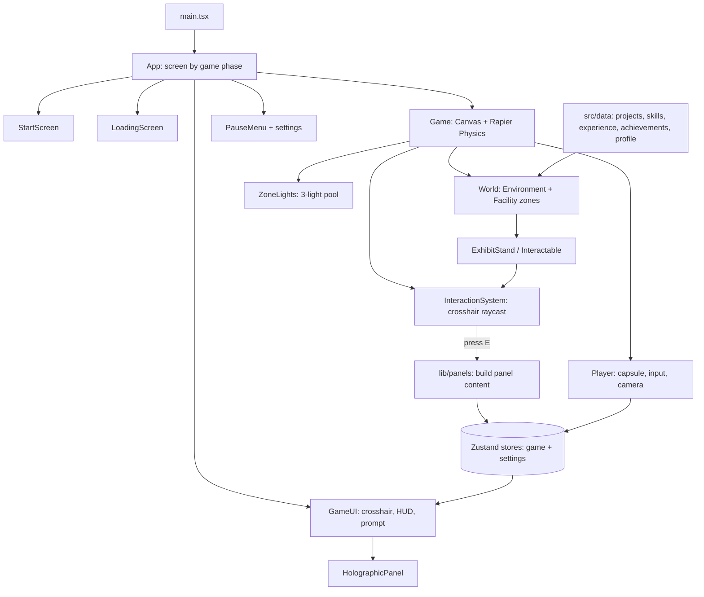

<div align="center">

# DIPSITA ROUT

### An interactive 3D portfolio you walk through, not scroll through.

*Enter a futuristic AI research facility. Find the projects. Press E.*

<br/>

**[ENTER THE WORLD](https://www.dipsitarout.tech/)** &nbsp;·&nbsp; **[GitHub](https://github.com/dipsitarout)** &nbsp;·&nbsp; **[LinkedIn](https://www.linkedin.com/in/dipsita-rout/)**

`React 19` &nbsp; `TypeScript` &nbsp; `Three.js` &nbsp; `React Three Fiber` &nbsp; `Rapier physics` &nbsp; `Vite`

</div>

<br/>

> **Hero image placeholder.** No screenshots are committed to this repository yet.
> Capture a 1600×900 screenshot of the starting plaza with the `DIPSITA ROUT` sign visible, save it as
> `docs/screenshots/hero.png`, and replace this block with:
> ``

---

## Contents

[Overview](#overview) · [Features](#features) · [Controls](#controls-and-navigation) · [Featured projects](#featured-projects) · [Tech stack](#technology-stack) · [Architecture](#architecture-and-project-structure) · [Getting started](#getting-started) · [Configuration](#configuration-and-environment-variables) · [Exploring](#how-to-explore-the-portfolio) · [Screenshots](#screenshots-and-visual-showcase) · [Deployment](#deployment) · [Engineering notes](#performance-and-engineering-decisions) · [Future ideas](#future-improvements) · [About](#about-the-developer) · [Connect](#connect-with-me) · [License](#license)

---

## Overview

This repository is my personal portfolio, built as a small first-person exploration game. Instead of a page of cards, a visitor spawns on a plaza outside a sci-fi research facility, walks in through the doors, and finds my work as physical objects in rooms: projects on pedestals, skills as floating nodes, experience along a timeline, achievements as trophies.

**Why a 3D world?** A portfolio is usually read in seconds and forgotten. I wanted the act of exploring to be part of the message: I work on AI/ML and full-stack applications, and I enjoy building interactive technology. The portfolio itself is a project that shows that.

**What visitors can explore**

| Zone | What is there |
|---|---|
| Starting Plaza | Spawn point, the hero sign, a navigation terminal, a facility map |
| Main Facility | Hall with a directory terminal and signs to the other areas |
| Profile Lab | Identity, education, a short introduction, and skill-category panels |
| Skills Lab | 30 interactive skill nodes in five groups |
| Project Lab | Seven project stations around a central core hologram |
| Experience Lab | A floor timeline with six interactive nodes |
| Achievement Chamber | Five collectible trophies |
| Contact Terminal | Closing terminal with contact buttons |

**Challenges this project addresses**

- Making a browser 3D scene feel like a game (movement, camera, collision) rather than a tech demo.
- Keeping portfolio content separate from 3D code, so content can be edited without touching the world.
- Keeping a large scene light enough to run in a normal browser tab (see [engineering notes](#performance-and-engineering-decisions)).

---

## Features

All items below are implemented in the code in this repository.

**World and rendering**
- Procedural geometry throughout (no model files): plaza, lobby, corridor, six themed rooms, pillars, server racks, doors, and a glass-railed island.
- Canvas-generated textures for floor tiles and holographic panels.
- Atmospheric fog, a starfield, a distant skyline drawn with instanced meshes, slowly rotating rings, and low-count ambient particles.
- Emissive materials with optional bloom.

**Player**
- Pointer-lock mouse look with smoothing and pitch clamping.
- Physics-based capsule player (Rapier) with acceleration and deceleration, sprint with a field-of-view increase, jump with coyote time, jump buffering and variable jump height.
- Head bob, walk sway, strafe tilt and a landing dip.
- Collision against every wall, pillar, pedestal, rack, terminal and door.

**Interaction**
- A ray from the crosshair finds the object you look at (range 3.5 m). Walls block it.
- Targeted objects glow, the crosshair turns into a ring, and an `[E] INTERACT` prompt with the object name appears.
- Pressing `E` opens a holographic panel with a scan-in animation. Movement is frozen while a panel is open.
- Sliding doors: one opens with `E`, the others open as you approach.

**HUD, menus and settings**
- Location label (`LOCATION: PROJECT LAB`), `[ESC] MENU` hint, crosshair, controls hint.
- Start screen, animated loading screen, pause menu (Resume, Settings, Controls, Exit to Menu).
- Settings: mouse sensitivity, master volume, graphics quality (Low / Medium / High), saved in `localStorage`.

**Audio** (generated with the Web Audio API, no audio files)
- Ambient drone with air noise and echoing data blips, footsteps, landing, door, interaction and hover sounds. Audio is ducked while paused.

**Responsive behaviour**
- On touch devices the start screen shows a message that the portfolio is a desktop experience instead of starting. There are no mobile controls.

**Content**
- Seven projects, 30 skills, six experience entries and five achievements, all driven from `src/data/`.

---

## Controls and Navigation

| Input | Action |
|---|---|
| `W` `A` `S` `D` | Move (backward is slightly slower) |
| `Mouse` | Look around (pointer lock) |
| `Shift` | Sprint (while moving forward) |
| `Space` | Jump |
| `E` | Interact with the object under the crosshair; press again to close an open panel |
| `Esc` | Release the mouse and open the pause menu. If a panel is open, closes it and opens the pause menu |
| Mouse click | Use menu buttons and panel buttons (CLOSE, GitHub, Live Demo, etc.) |

**Flow:** click **ENTER THE WORLD** → loading screen → you spawn in the plaza with the mouse captured → walk and look → press `E` on highlighted objects → `Esc` to pause.

While a panel is open the cursor is released so its buttons are clickable. Closing it with **CLOSE** or `E` recaptures the mouse.

> Browsers briefly refuse to re-capture the mouse right after `Esc`. If **Resume** does not capture it immediately, click **Resume** once more.

---

## Featured Projects

Project information lives in [`src/data/projects.ts`](src/data/projects.ts). Entries marked *(to be added)* have no verified information yet; this README does not guess.

### 1. DiseaseRisk AI
Explainable multi-agent disease risk assessment and clinical decision-support system.
- **Problem:** assessing disease risk and supporting clinical decisions with explanations rather than a bare score.
- **Stack:** React, FastAPI, PostgreSQL, Machine Learning, SHAP, LangGraph, RAG
- **Agents:** Prediction, Explanation, Verification, Recommendation
- **Features:** ML-based risk prediction, SHAP explanations, RAG-based clinical context, clinical risk report, doctor dashboard
- **Links:** GitHub *(to be added)* · Demo *(to be added)*
- *Not a medical device. Outputs are not clinically validated.*

### 2. ClinSight
AI-powered clinical intelligence and decision-support platform.
- **Problem:** *(to be added)*
- **Stack:** React, FastAPI, Gemini API, RAG, FAISS, Chroma, OCR, LangGraph / multi-agent architecture
- **Features:** document ingestion, OCR extraction, vector retrieval, patient context, RAG-based clinical reasoning, agent orchestration, audit-trail concept
- **Links:** GitHub *(to be added)* · Demo *(to be added)*
- *Not a medical device. Outputs are not clinically validated.*

### 3. KrishiDeep
AI/ML agriculture intelligence project.
- **Problem, stack, features:** *(to be added)*
- **Links:** GitHub *(to be added)* · Demo *(to be added)*

### 4. ThreatShield
AI-powered cybersecurity / threat intelligence project.
- **Problem, stack, features:** *(to be added)*
- **Links:** GitHub *(to be added)* · Demo *(to be added)*

### 5. Event Portal
Full-stack event management platform.
- **Problem:** managing events through a web platform.
- **Stack:** React, Node.js, Express.js, MongoDB
- **Features:** *(to be added)*
- **Links:** GitHub *(to be added)* · Demo *(to be added)*

### 6. AI PDF Knowledge Assistant
Retrieval-Augmented Generation chatbot for asking questions about uploaded PDFs, with grounded answers and page-level citations.
- **Problem:** getting trustworthy, source-backed answers from long PDF documents.
- **Stack:** Python, Streamlit, LangChain, Groq, Llama 3.1, Sentence Transformers, FAISS, PyPDFLoader, RAG
- **Features:** multi-PDF upload and querying, semantic search, RAG pipeline, document-grounded answers, page-level source citations, metadata filtering by document and page range, conversational memory, context-aware query rewriting, PDF page preview for sources, chat export as PDF
- **Links:** [GitHub](https://github.com/dipsitarout/AI-PDF-ASSISANT) · [Live demo](https://roqslrsyx4emtyn88iczd9.streamlit.app/)

### 7. Library Management System
Full-stack library management application.
- **Problem, stack, features:** *(to be added)*
- **Links:** GitHub *(to be added)* · Demo *(to be added)*

---

## Technology Stack

Versions are the ranges declared in [`package.json`](package.json).

| Category | Technologies |
|---|---|
| **Framework and language** | `React 19` `TypeScript` |
| **3D and graphics** | `three 0.186` `@react-three/fiber 9` `@react-three/drei 10` `@react-three/postprocessing 3` |
| **Physics** | `@react-three/rapier 2` |
| **State** | `Zustand 5` |
| **Animation** | `GSAP 3` |
| **Styling** | Plain CSS (`src/index.css`); fonts Orbitron and Rajdhani from Google Fonts |
| **Build tooling** | `Vite 8` `@vitejs/plugin-react 6` |
| **Audio** | Browser Web Audio API (no library) |

---

## Architecture and Project Structure

### How it works

1. `main.tsx` mounts `App`. `App` renders a screen based on a single **game phase** in a Zustand store: `menu → loading → playing ⇄ paused`.
2. Clicking **ENTER THE WORLD** requests pointer lock and unlocks audio (both need a user click), then the phase moves to `loading`.
3. During `loading`, `Game` mounts the React Three Fiber `Canvas`. Rapier initialises inside `Suspense`; when the physics world is ready a `ReadySignal` flips `worldReady`, and the loading screen finishes and starts play.
4. `World` builds the environment and the facility from zone components. Content-bearing objects are generated from the files in `src/data/`.
5. Each frame, `Player` reads input, sets the physics body's velocity and positions the camera. `InteractionSystem` raycasts from the crosshair a few times per second and updates the store with the current target.
6. `E` calls the target's handler, which opens a panel by writing panel content to the store; `HolographicPanel` renders it.



### Directory tree

```text
portfolio-game/
├── index.html                 # Entry HTML, loads Google Fonts
├── package.json               # Scripts and dependencies
├── vite.config.ts             # Vite + React plugin
├── tsconfig.json              # Strict TypeScript
└── src/
    ├── main.tsx               # React entry
    ├── App.tsx                # Chooses the screen from the game phase
    ├── index.css              # All styling (menus, HUD, holographic panel)
    ├── data/                  # Portfolio content (edit these to change the content)
    │   ├── projects.ts        # Project stations and panel content
    │   ├── skills.ts          # Skill groups and nodes
    │   ├── experience.ts      # Experience timeline nodes
    │   ├── achievements.ts    # Trophies
    │   ├── profile.ts         # Identity, introduction, contact links
    │   └── types.ts           # Shared panel content types
    ├── store/
    │   ├── gameStore.ts       # Phase, pause view, interact target, open panel, location
    │   └── settingsStore.ts   # Sensitivity, volume, quality (persisted)
    ├── lib/
    │   ├── audio.ts           # Procedural Web Audio
    │   ├── panels.ts          # Data → panel content; open/close panel (pointer lock aware)
    │   ├── interactables.ts   # Registry of targetable objects and ray occluders
    │   ├── textures.ts        # Canvas textures: floor tiles, holographic panels
    │   └── zones.ts           # Zone bounds, names and light positions
    ├── components/
    │   ├── Game.tsx           # Canvas, physics, quality manager, bloom, lifecycle
    │   ├── Player.tsx         # Movement, jump, camera, bob, footsteps
    │   ├── InteractionSystem.tsx  # Crosshair raycast and E handling
    │   ├── Interactable.tsx   # Makes an object targetable and glow on target
    │   ├── GameUI.tsx         # Crosshair, prompt, location, hints
    │   ├── HolographicPanel.tsx   # Animated info panel
    │   ├── StartScreen.tsx · LoadingScreen.tsx · PauseMenu.tsx
    │   └── World.tsx          # Environment + Facility
    └── world/
        ├── Facility.tsx       # Floors, shell, doors, zone composition
        ├── Environment.tsx    # Fog, sky, skyline, particles, sun light
        ├── ZoneLights.tsx     # Light pool that follows the current zone
        ├── walls.tsx          # Wall builder with door openings
        ├── primitives.tsx     # Block, Door, Terminal, HoloPanel, Pillar, ...
        ├── ExhibitStand.tsx   # Pedestal + hologram, glows when targeted
        └── zones/             # Plaza, Lobby, Corridor, ProfileLab, SkillsLab,
                               # ProjectLab (+ ProjectStation), ExperienceLab,
                               # AchievementsLab, ContactLab
```

**Content flow.** `ProjectLab` loops over `projects` and renders a `ProjectStation` for each; interacting with a station calls `projectPanel(project)`, which maps the same data object to panel content. Skills, experience and achievements follow the same pattern. Editing a file in `src/data/` updates both the 3D station and its panel.

---

## Getting Started

**Prerequisites:** Node.js `^20.19.0` or `>=22.12.0` (required by Vite 8) and npm.

```bash
# 1. Clone
git clone https://github.com/dipsitarout/portfolio-game.git
cd portfolio-game

# 2. Install
npm install

# 3. Run the dev server (Vite default: http://localhost:5173)
npm run dev
```

Open the printed local URL in a desktop browser and click **ENTER THE WORLD**.

```bash
# Type-check and create a production build in dist/
npm run build

# Serve the production build locally
npm run preview
```

`npm run build` runs `tsc --noEmit` followed by `vite build`, so type errors fail the build.

---

## Configuration and Environment Variables

No environment configuration is needed for the current setup. The code does not read any environment variables, and there are no API keys or secrets in the repository.

Content is configured in TypeScript files under `src/data/`. Buttons only become clickable when a URL is filled in:

| File | Field | Effect |
|---|---|---|
| `src/data/projects.ts` | `github`, `demo` | Enables the project's GitHub / Live Demo buttons (empty string = disabled) |
| `src/data/profile.ts` | `contactLinks[].url` | Enables the Contact Terminal buttons |

---

## How to Explore the Portfolio

1. Open **[dipsitarout.tech](https://www.dipsitarout.tech/)** on a desktop or laptop.
2. Click **ENTER THE WORLD**. Allow the mouse to be captured.
3. Skim the controls on the HUD (bottom-left): `WASD`, `Shift`, `Space`, `E`, `Esc`.
4. Follow the glowing floor rails to the facility entrance. The navigation terminal near the spawn and the facility directory in the main hall explain where each area is.
5. Walk through the doors. Profile Lab and Skills Lab are off the main hall; the Project Lab is straight ahead through the corridor; Experience, Achievements and Contact branch off the Project Lab.
6. Look at a project station until it glows, press `E`, and read the panel. Use **GitHub** / **Live Demo** where available, then **CLOSE** (or `E`) to keep exploring.

---

## Screenshots and Visual Showcase

No screenshots are committed yet, so no images are embedded here (to avoid broken links). Suggested captures, saved to `docs/screenshots/`:

| Filename | What to capture |
|---|---|
| `hero.png` | Plaza spawn view with the `DIPSITA ROUT` sign |
| `project-lab.png` | Project Lab with several stations and the core hologram |
| `project-panel.png` | An open project panel (the AI PDF Knowledge Assistant panel is the richest) |
| `skills-lab.png` | A skill node glowing under the crosshair with the `[E] INTERACT` prompt |
| `achievements.png` | The trophy row |
| `walkthrough.gif` | 10 to 15 second clip: plaza → hall → Project Lab → open a panel |

When the files exist, add them with `" alt="..." width="100%"/>`.

---

## Deployment

The live site is **[dipsitarout.tech](https://www.dipsitarout.tech/)**.

The app is a static single-page build: `npm run build` produces `dist/`, which can be served by any static host (no server code, no client-side router, no environment variables). The hosting provider and DNS setup are not documented in this repository, so they are intentionally not described here.

General steps: run `npm run build`, upload or connect the repository to a static host with `dist/` as the output directory, and point the domain at it.

---

## Performance and Engineering Decisions

Everything here is visible in the code; there are no benchmark claims.

- **Procedural content over assets.** There are no 3D models. Geometry is boxes, cylinders, tori and polyhedra; textures are drawn on canvases; sound is synthesised. This keeps the repository small and the content easy to change.
- **Fixed light budget.** The facility is large, so instead of one light per room a pool of three point lights glides to the current zone's light positions (`ZoneLights`). The shader's light count never changes, avoiding recompiles, and glow comes mostly from emissive materials (and bloom on High).
- **Instancing.** The distant skyline is two instanced meshes.
- **Quality levels.** Low: shadows off, pixel ratio 1, fewer particles, no bloom. Medium (default): shadows, pixel ratio up to 1.25. High: pixel ratio up to 2 and bloom.
- **Single shadow-casting light** with a 2048 shadow map aimed at the facility.
- **State outside React's render loop.** Per-frame work (movement, camera, interaction checks) reads and writes refs and `store.getState()`, and the interaction ray runs about every 80 ms, so React re-renders only when something visible changes (target, panel, location).
- **Input.** Keys and mouse deltas are read in event listeners into refs; the mouse delta is ignored during pointer-lock spikes; input is cleared on blur and pause.
- **Physics.** The player is a dynamic Rapier capsule whose horizontal velocity is damped toward the target each frame. Ground detection is a downward raycast. Colliders are real cuboids and cylinders for everything solid.
- **Data-driven content.** Types in `src/data/types.ts` and mapping in `src/lib/panels.ts` keep 3D components free of portfolio text.
- **Textures.** Panel textures skip mipmaps to save memory.
- **Bundle.** The last production build was a single JavaScript file of about 3.6 MB (about 1.2 MB gzipped), mostly Three.js and the physics engine. There is no code splitting yet.
- **Browser support.** Requires WebGL, the Pointer Lock API and Web Audio. It targets desktop browsers; systematic cross-browser testing has not been done.

---

## Future Improvements

These are ideas, not completed features.

- Touch controls or a simplified mobile view.
- Keyboard-only and reduced-motion options; subtitles or visual cues for audio.
- Code-splitting and lazy-loading the 3D scene to shrink the initial download.
- Richer project previews (screenshots or short clips inside the panel).
- Filling in the remaining project details and links once they are available.
- A minimap or teleport shortcuts for returning visitors.
- Automated tests for the data mapping and layout (walkable routes).

---

## About the Developer

I'm **Dipsita Rout**, a B.Tech Computer Science and Engineering student specialising in Artificial Intelligence and Machine Learning at **VIT Chennai**. I'm interested in AI and machine learning, full-stack development, interactive web experiences and software engineering, and I like building practical, user-focused applications. My work includes RAG-based and multi-agent systems alongside full-stack web apps.

---

## Connect With Me

**Portfolio:** [dipsitarout.tech](https://www.dipsitarout.tech/) &nbsp;·&nbsp; **GitHub:** [github.com/dipsitarout](https://github.com/dipsitarout) &nbsp;·&nbsp; **LinkedIn:** [linkedin.com/in/dipsita-rout](https://www.linkedin.com/in/dipsita-rout/)

If something here caught your eye, walk in and have a look around. I'd love to hear what you think.

---

## License

No license file was found in this repository, so no license is granted by default and all rights are reserved by the author. The repository owner can add a `LICENSE` file to choose one.
